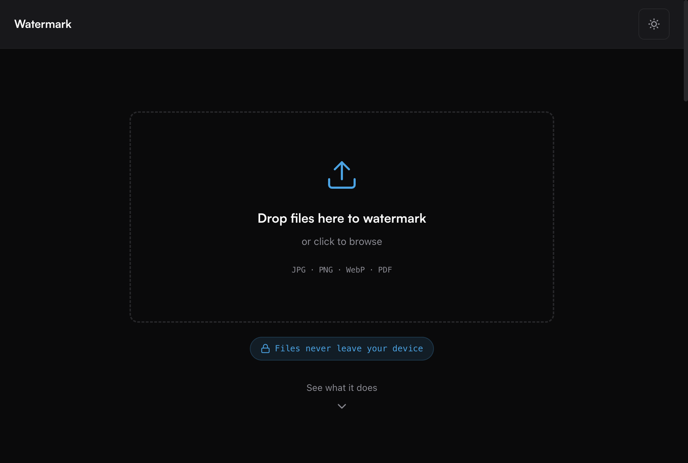
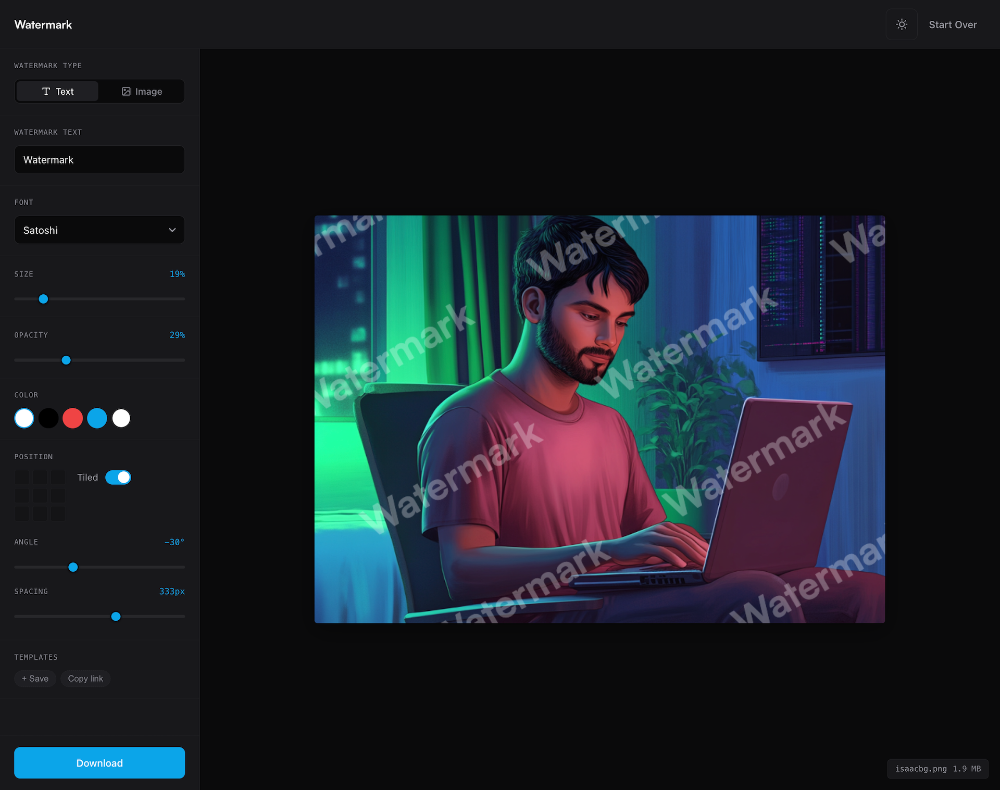

# Watermark

A browser-only tool to add text or logo watermarks to **images** (JPG, PNG, WebP) and **PDFs**. Drop files, tune the watermark, preview in real time, then download individually or as a ZIP batch. **Nothing is uploaded** — processing stays on your device.

**Live app:** [watermarker-inky.vercel.app](https://watermarker-inky.vercel.app/)

### Landing



### Editor



## Features

- Drag-and-drop or click to add files (up to **50** files, **50 MB** each)
- Text or image watermarks, positions, opacity, rotation, tiling
- **PDF** support via pdf.js + pdf-lib (rasterized pages at 2× for output)
- **Batch export** as a ZIP (processed in chunks with DEFLATE compression)
- **Templates** saved in `localStorage` (up to 20)
- **PWA**-ready (installable, offline-capable after first load)
- Dark / light theme

## Tech stack

- [React](https://react.dev/) 19 · [Vite](https://vitejs.dev/) 8
- [pdfjs-dist](https://mozilla.github.io/pdf.js/) · [pdf-lib](https://pdf-lib.js.org/) · [JSZip](https://stuk.github.io/jszip/)

## Development

Requires [Bun](https://bun.sh/) (or use `npm` / `pnpm` / `yarn` with equivalent commands).

```bash
bun install
bun run dev      # http://localhost:5173
bun run build    # output in dist/
bun run preview  # serve production build
bun run lint
```

Tests (Vitest):

```bash
bunx vitest run
```

## Project layout

| Path | Role |
|------|------|
| `src/App.jsx` | Root state, file validation, toasts |
| `src/components/Editor.jsx` | Sidebar + canvas workspace, download / ZIP |
| `src/lib/watermarkRenderer.js` | Shared canvas drawing for image + PDF |
| `src/lib/imageProcessor.js` | Full-res export + debounced preview |
| `src/lib/pdfProcessor.js` | PDF load, watermark, new PDF output |
| `src/lib/batchCoordinator.js` | Chunked batch + ZIP |
| `src/lib/templateManager.js` | Template CRUD in `localStorage` |

## Privacy

All watermarking runs in your browser. Files are not sent to a server for processing.
